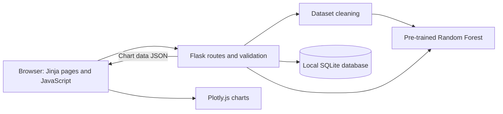

# GradePath

GradePath is a Flask web app that estimates student GPA and letter grades from
behavioural and support-related factors. It uses a pre-trained Random Forest
model for inference; the app does not train or modify the model.

## Features

- Predict GPA for one student with an interactive form.
- Upload a CSV or XLSX roster (up to 5 MB), clean its data, and predict for each
  row.
- View saved analyses in a dashboard with GPA and grade charts, feature
  importance, and a prediction table.
- Compare predictions with actual GPA or grade data when the uploaded file
  includes `GPA` and/or `GradeClass`.
- Download an analysis as a CSV file.

## How it works



For a single prediction, the server validates the nine input features and returns
a GPA, letter grade, a range based on the spread of the model's tree predictions,
and global feature importance. The prediction is not saved.

For a dataset upload, the app checks the file, cleans and validates the feature
columns, predicts each cleaned row, and saves the analysis and results to the
local SQLite database. The source upload is processed in memory and is not saved
as a file. Analysis history remains in `gradepath.db`.

## Model inputs

The model expects these columns, in this exact order:

1. `StudyTimeWeekly`
2. `Absences`
3. `Tutoring`
4. `ParentalSupport`
5. `ParentalEducation`
6. `Extracurricular`
7. `Sports`
8. `Music`
9. `Volunteering`

Age, gender, and ethnicity are not used as model inputs. Values outside the
configured ranges or values that cannot be converted to numbers are treated as
missing in uploaded data. Missing continuous values are filled with the median;
missing binary and ordinal values are filled with the mode. Rows with duplicate
required feature values are removed. Files missing required feature columns are
rejected rather than guessed.

| Predicted GPA | Grade |
|---:|:---:|
| 3.50–4.00 | A |
| 3.00–3.49 | B |
| 2.50–2.99 | C |
| 2.00–2.49 | D |
| Below 2.00 | F |

## Technology

- Python 3.10+
- Flask and Jinja2
- pandas, NumPy, scikit-learn, joblib, and openpyxl
- SQLite using Python's built-in `sqlite3`
- HTML, CSS, and vanilla JavaScript
- Plotly.js and Google Fonts loaded from CDNs

## Run locally

The trained model is included at `model/student_performance_modelv2.joblib`.
From the repository root, create a virtual environment and install dependencies.

### Windows PowerShell

```powershell
py -3 -m venv .venv
.\.venv\Scripts\Activate.ps1
python -m pip install -r requirements.txt
python backend\app.py
```

### macOS or Linux

```bash
python3 -m venv .venv
source .venv/bin/activate
python -m pip install -r requirements.txt
python backend/app.py
```

Open [http://127.0.0.1:5000](http://127.0.0.1:5000). The database tables are
created automatically on startup. The local database and virtual environment
are excluded by `.gitignore`.

## Deploy to Vercel

Vercel uses the root-level `app.py` entrypoint, installs Python dependencies
from `requirements.txt`, and serves browser assets from `public/static/`. Deploy
from this repository root using the Vercel CLI or a connected Git repository.

The app is live at <https://grade-path-999-ecru.vercel.app/>. Each push to
`main` triggers a new deployment through the connected Git repository.

Vercel functions use temporary writable storage. GradePath places SQLite there
by default when running on Vercel, so saved analyses are **not durable** and may
disappear between function instances or restarts. Set `GRADEPATH_DB_PATH` only
when you have a writable database location; for persistent analysis history,
migrate the SQLite layer to a managed database before using the app with real
student data.

## Tests

The test suite uses Flask's test client and synthetic CSV fixtures:

```bash
python -m unittest discover -s scripts -p "test_system.py" -v
```

It covers single predictions, input validation, clean and unclean dataset
uploads, missing columns, invalid file types, dashboard data, and CSV export.

## Main routes

| Method | Route | Purpose |
|---|---|---|
| `GET` | `/` | Single-student prediction form |
| `POST` | `/predict` | Return one prediction as JSON |
| `GET`, `POST` | `/upload` | Upload and analyze a dataset |
| `GET` | `/dashboard` | Open the latest analysis |
| `GET` | `/dashboard/<analysis_id>` | Open a saved analysis |
| `GET` | `/api/dashboard/<analysis_id>` | Return chart data as JSON |
| `GET` | `/download/<analysis_id>.csv` | Download prediction results |

## Repository layout

```text
backend/       Flask routes, configuration, cleaning, model, and database code
model/         Pre-trained model and grade cutoff metadata
templates/     Jinja2 pages
static/        CSS and browser JavaScript
scripts/       Test suite and synthetic test-data generator
test_data/     Synthetic clean and unclean CSV fixtures
design/        Visual mockup
```

## Privacy and deployment

This project has no authentication or authorization. Analyses and student-level
predictions are available to anyone who can access the running app. Use it only
with data you are authorized to process, and do not expose this development
server publicly. The built-in Flask server runs in debug mode; production use
requires a production WSGI server, debug mode disabled, HTTPS, persistent
database storage, and appropriate access controls.
